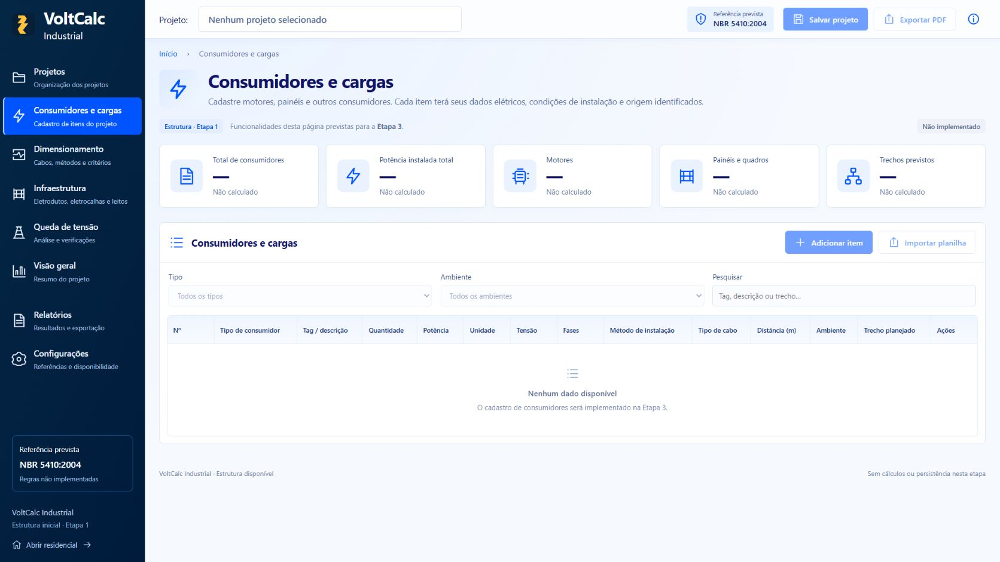
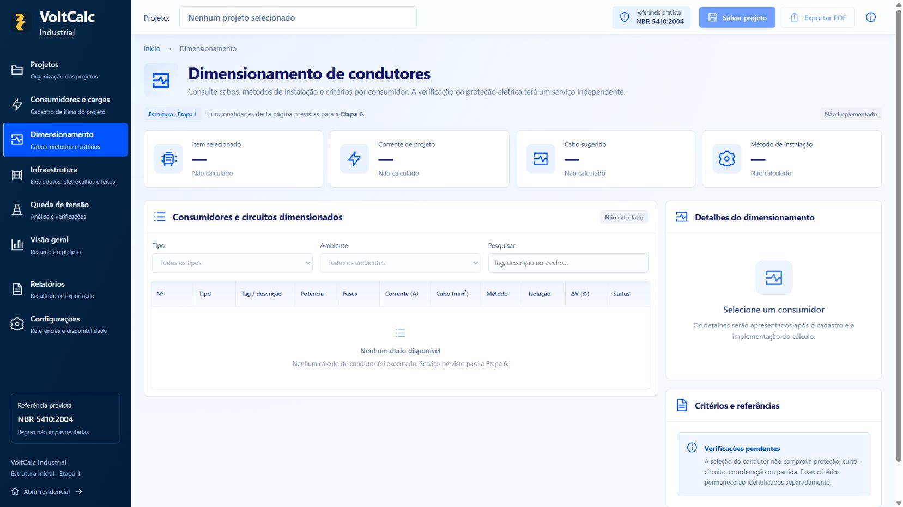

# VoltCalc Industrial — Etapa 1: estrutura

Data: 24/10/2026. **Situação: concluída no escopo autorizado. Etapa 2 não iniciada.**

Árvore utilizada: `C:\Users\jeanm\OneDrive\Desktop\dimensionamento`.

## 1. Entrega

Foi implementada a estrutura isolada do VoltCalc Industrial, com entrada própria, navegação funcional, componentes visuais reutilizáveis, modelos compartilhados entre Python e JavaScript, validação estrutural, estado com revisão/invalidação e interfaces abstratas para armazenamento e serviços futuros.

O roteiro original das Etapas 0 a 11 foi preservado. Os cadastros, persistência, cálculos, infraestrutura, mapa e exportações das próximas etapas **não foram implementados nem simulados**.

### Acesso

Com o servidor Python em execução:

- Industrial: `http://127.0.0.1:8000/industrial/`;
- Residencial: `http://127.0.0.1:8000/`.

```powershell
Set-Location 'C:\Users\jeanm\OneDrive\Desktop\dimensionamento'
python server.py
```

O servidor foi iniciado para a verificação visual. Quando necessário, reinicie-o após mudanças na lista de arquivos públicos. Nenhuma dependência de execução ou etapa de build foi acrescentada.

## 2. Funcionalidades implementadas

### Estrutura visual e navegação

A interface segue os conceitos das seis referências industriais: lateral azul-escura, indicação azul da página selecionada, cabeçalho compacto, identificação do projeto atual, referência normativa, indicadores claros, tabelas e painéis contextuais. A página de consumidores utiliza a largura principal completa, sem assistente lateral.

As oito rotas funcionam por fragmento de URL e suportam recarregamento direto:

| Ordem | Página | Rota |
|---|---|---|
| 1 | Projetos | `/industrial/#/projetos` |
| 2 | Consumidores e cargas | `/industrial/#/consumidores` |
| 3 | Dimensionamento | `/industrial/#/dimensionamento` |
| 4 | Infraestrutura | `/industrial/#/infraestrutura` |
| 5 | Queda de tensão | `/industrial/#/queda-de-tensao` |
| 6 | Visão geral | `/industrial/#/visao-geral` |
| Auxiliar | Relatórios | `/industrial/#/relatorios` |
| Auxiliar | Configurações | `/industrial/#/configuracoes` |

Visão geral contém apenas a área reservada ao mapa da Etapa 9. Não existe topologia demonstrativa ou editor antecipado. Configurações explica o estado da base normativa e do armazenamento. A ajuda descreve as etapas futuras, sem habilitá-las.

O cabeçalho mostra **Nenhum projeto selecionado**. Os indicadores utilizam “—”, “Não calculado” ou “Pendente de dados”. Salvar, importar, exportar, filtrar e adicionar estão desabilitados e associados à etapa prevista. Não há projetos fictícios, valores elétricos das imagens, selo “Conforme” ou temperatura de cabo inventada.

Foram implementados menu responsivo, foco visível, identificação da página atual, atalho para conteúdo, rolagem local das tabelas e ajuda em modal com Escape e retorno de foco.

### Componentes reutilizáveis

`components.js` disponibiliza ícones SVG, indicadores, campos/formulários com erro, ações, badges, painéis, tabelas, avisos e estados vazios. Os textos variáveis são escapados antes de compor o HTML. O estilo industrial é independente dos estilos residenciais.

### Modelos e validação inicial

O contrato declarativo `data/industrial/contracts.v1.json` define os nove modelos exigidos: Projeto, Consumidor, Motor, Painel, Circuito, Trecho, Condutor, Infraestrutura e Resultado de Cálculo. Alimentação, origem de dados, nó de topologia, critério e medição são objetos auxiliares.

Há fábricas e validadores em Python e JavaScript, alimentados pelo mesmo arquivo e verificados com casos de teste comuns. A validação inicial cobre tipos, enums, números finitos, limites estruturais, inteiros, campos desconhecidos, versão, IDs repetidos e referências entre coleções.

Dados elétricos desconhecidos permanecem `null`. Um rascunho vazio pode ser estruturalmente válido, mas isso não o torna calculável. A validação elétrica contextual, os critérios normativos e a verificação completa de grafos pertencem às próximas etapas.

### Estado, invalidação e serviços

O estado industrial começa sem projeto carregado. O mecanismo preparado:

- copia entradas para evitar alteração externa do estado;
- valida alterações antes de aceitá-las;
- incrementa a revisão e invalida resultados após edição;
- identifica requisições por projeto, revisão, domínio e versões;
- rejeita respostas antigas ou incompatíveis;
- invalida resultados restaurados sem validade para as entradas/referências atuais;
- impede resultados numéricos ou critérios aprovados enquanto a base estiver não implementada.

A invalidação inicial é conservadora: qualquer edição invalida todos os resultados do projeto. A dependência seletiva poderá ser implementada quando os serviços e a topologia correspondentes existirem.

`ProjectRepository` define operações assíncronas de listagem, leitura, gravação, duplicação e exclusão, com revisão esperada nas mutações. Todos os métodos informam indisponibilidade nesta etapa. **Nenhuma tecnologia de persistência foi selecionada ou implementada.**

`ConductorService` e `ProtectionService` são contratos distintos em Python e JavaScript. Não existem implementações de cálculo industrial ou endpoints industriais de cálculo. A seleção de condutores não implica verificação de proteção.

### Referência normativa

O registro industrial identifica o escopo previsto como `nbr-5410-2004`, versão `2004-unimplemented-v1`, estado `not_implemented` e lista de tabelas vazia. A interface exibe **Referência prevista** e **Regras não implementadas**.

Esse registro não constitui adoção validada da edição, declaração de vigência ou conformidade. Não há importação das regras/tabelas residenciais de 1997 pelo módulo industrial. Fontes, tabelas e notas serão verificadas na etapa de cálculo correspondente.

## 3. Arquivos da entrega

### Único arquivo existente modificado nesta etapa

- `voltcalc/web/assets.py`: adiciona a lista explícita dos recursos industriais, o contrato compartilhado, a entrada `/industrial/` e o redirecionamento de `/industrial`. As inclusões residenciais que já estavam no arquivo antes desta etapa foram preservadas.

### Novos arquivos de aplicação

```text
data/industrial/contracts.v1.json
voltcalc/industrial/__init__.py
voltcalc/industrial/contracts.py
voltcalc/industrial/services.py
frontend/industrial/index.html
frontend/industrial/css/industrial.css
frontend/industrial/js/app.js
frontend/industrial/js/components.js
frontend/industrial/js/pages.js
frontend/industrial/js/core/model.js
frontend/industrial/js/core/repository.js
frontend/industrial/js/core/routes.js
frontend/industrial/js/core/services.js
frontend/industrial/js/core/state.js
```

### Novos testes

```text
tests/industrial/__init__.py
tests/industrial/contract_cases.json
tests/industrial/test_structure.py
tests/industrial/structure.test.mjs
```

### Documentação e evidências

- [DECISOES_ARQUITETURAIS.md](DECISOES_ARQUITETURAIS.md): decisões tomadas agora e consequências para as próximas etapas;
- [PENDENCIAS.md](PENDENCIAS.md): acompanhamento das ressalvas SENAI/Etapa 0, prioridade e etapa prevista;
- `docs/industrial/ETAPA_01.md`: este relatório;
- `docs/industrial/evidencias/etapa01_projetos_desktop.png`;
- `docs/industrial/evidencias/etapa01_consumidores_desktop.png`;
- `docs/industrial/evidencias/etapa01_dimensionamento_desktop.png`;
- `docs/industrial/evidencias/etapa01_dimensionamento_mobile.png`.

Logs e manifesto temporário de preservação foram mantidos em `tmp/`, pasta já ignorada pelo Git. Não são recursos públicos nem dados de projeto.

## 4. Preservação do residencial

O motor, tabelas, API, modelo, armazenamento, HTML, estilos e fluxos residenciais não foram alterados. A comparação por SHA-256 de **106 arquivos preexistentes**, excluindo a integração autorizada em `assets.py` e o diretório industrial, não detectou alterações inesperadas. A mudança em `assets.py` foi revisada separadamente e é aditiva para o industrial.

Não houve leitura, limpeza ou gravação de projetos residenciais pelo módulo industrial; ele não acessa localStorage. Nenhum banco foi criado, excluído, substituído ou migrado. Não foram corrigidas ressalvas SENAI fora do escopo. Alterações locais anteriores à Etapa 1 foram preservadas e não são apresentadas como parte desta entrega.

## 5. Testes executados

| Comando | Resultado |
|---|---|
| `python -m unittest discover -s tests -q` | **87 testes aprovados**: 80 existentes e 7 industriais |
| `node tests/grid.test.cjs` | Aprovado |
| `node tests/model.test.cjs` | Aprovado |
| `node tests/report.test.mjs` | Aprovado |
| `node tests/rooms.test.mjs` | Aprovado |
| `node tests/ux.test.mjs` | Aprovado |
| `node tests/industrial/structure.test.mjs` | Aprovado; repetido após o ajuste final das guardas de resultado |
| `git diff --check -- voltcalc/web/assets.py` | Sem problemas de whitespace |

Os novos testes Python verificam os casos compartilhados, valores inválidos, instâncias independentes, referências, duplicidade, registro normativo vazio, entrada/redirecionamento, dependências JS servidas, privacidade de código e ausência de endpoint industrial de cálculo.

A suíte JavaScript verifica validação, cópias de estado, atomicidade de alterações inválidas, revisão/invalidação, respostas antigas, versões incompatíveis, colisão de IDs, recusa de medições/verificações indevidas, contrato de repositório, separação de serviços, ordem das rotas, estados vazios e escape de texto. Os testes são de estrutura e contratos; não representam validação de dimensionamento industrial.

### Verificação no navegador

- Navegação pelas oito páginas com correspondência entre título e item selecionado.
- Recarregamento de rota interna sem perda da navegação.
- Desktop em 1672 × 941, permitindo comparar a composição com as referências.
- Tela estreita em 390 × 844: inspeção de Dimensionamento, Infraestrutura, Projetos, Consumidores e Configurações; nenhuma rolagem horizontal da página nas verificações. Tabelas preservam rolagem local.
- Abertura do menu móvel, navegação e fechamento com foco no título da página.
- Ajuda aberta e fechada por Escape, com retorno de foco ao botão de origem.
- Atalho “Ir para o conteúdo” transfere foco para `main` sem trocar a rota.
- Nenhum erro ou aviso registrado no console durante as verificações finais.

O viewport temporário foi restaurado ao final. A prévia industrial ficou disponível para revisão.

### Evidências





## 6. Limitações e pendências

Não há CRUD industrial, salvamento, importação efetiva, filtros operacionais, cadastro de cargas, cálculo de motores, topologia editável, seleção de cabos, proteção, ocupação, queda ou exportação industrial. Esses controles estão desabilitados, e a referência normativa continua não implementada.

O contrato preparado não substitui as validações elétricas e de completude futuras. A arquitetura de serviço está separada, mas nenhum serviço foi declarado concluído. Os dados e critérios das imagens são apenas referências visuais.

As ressalvas técnicas e os problemas residenciais identificados estão em [PENDENCIAS.md](PENDENCIAS.md). A luminotécnica e eventuais correções residenciais continuam fora da autorização atual. Proteção completa, curto-circuito, coordenação e partida não podem ser declarados verificados por meio das telas estruturais ou da futura seleção de cabo.

Não foram observadas falhas nos testes finais ou bloqueios para a entrega estrutural desta etapa. Isso não equivale a homologação dos cálculos industriais, ainda inexistentes.

## 7. Aceitação da Etapa 1

| Requisito | Situação |
|---|---|
| Utilizar somente a árvore ativa | Atendido |
| Preservar arquitetura e dados residenciais | Atendido no escopo da entrega; arquivos comparados e regressão aprovada |
| Estrutura visual e navegação conforme sequência original | Atendido |
| Identificação do projeto atual sem dados fictícios | Atendido: nenhum projeto selecionado |
| Componentes reutilizáveis | Atendido |
| Nove modelos exigidos e validação inicial | Atendido |
| Mecanismo de revisão e invalidação | Atendido e testado |
| Repositório abstrato, sem escolher persistência da Etapa 2 | Atendido |
| Separação de condutores e proteção | Atendido nos contratos |
| Referências normativas isoladas e versionadas | Atendido; regras não implementadas |
| Estados explícitos para funções futuras | Atendido |
| Decisões e pendências documentadas | Atendido |
| Regressão residencial e testes industriais | Atendido |
| Não antecipar próximas etapas | Atendido |

**Encerramento:** Etapa 1 entregue. A Etapa 2 somente poderá começar após confirmação expressa do usuário.
