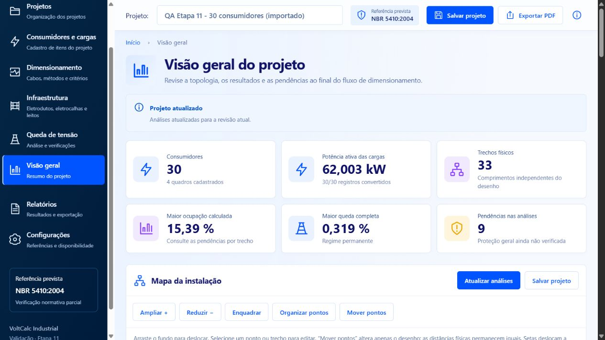

# Etapa 11 — Testes finais e validação

Conclusão: 30/10/2026. Ensaios iniciados em 29/10/2026.

**Auditoria concluída com ressalvas.** A regressão passou no escopo implementado. Isso não significa conformidade integral com a NBR 5410 nem conclusão das funcionalidades explicitamente não implementadas. O roteiro original 0–11 foi preservado; nenhuma nova etapa foi criada.

## Escopo e preservação

Trabalho exclusivamente na árvore `C:\Users\jeanm\OneDrive\Desktop\dimensionamento`. Motor e dados residenciais preservados: comparação SHA-256 dos 105 arquivos protegidos da linha de base da Etapa 6 sem alterações. Ressalvas SENAI e da Etapa 0 continuam registradas; não foram corrigidas silenciosamente. Não houve exclusão de registros do usuário. Navegação e importação de QA restritas à origem 8001; exclusão automatizada somente em armazenamento sintético em memória.

## Correções encontradas na auditoria

| Arquivo | Alteração nesta etapa |
|---|---|
| `frontend/industrial/js/conductors-view.js` | Substitui aviso histórico de etapas futuras por orientação para consultar as análises existentes de ocupação e queda. Não modifica resultados do serviço. |
| `frontend/industrial/js/infrastructure-view.js` | Alimentadores exibem o quadro de destino vinculado, em vez de uma pendência enganosa na coluna de cargas. |
| `frontend/industrial/js/core/currents.js` | Explica que cargas especiais exigem análise por item e que a soma da visão geral não resolve cadeias de transformação/acionamento. |
| `frontend/industrial/js/pages.js` | Atualiza disponibilidade real dos serviços e explicita verificações ainda ausentes. |
| `frontend/industrial/js/app.js` | Identifica a entrega como Validação / Etapa 11. |
| `voltcalc/industrial/reports.py` | Explicita ausência de análise de aterramento, curto-circuito e balanço de energia de cadeias de cargas. |
| `voltcalc/industrial/report_pdf.py` | Corrige símbolos gregos ausentes nas fórmulas por fonte suplementar incorporada ao PDF. |
| `voltcalc/industrial/fonts/` | Noto Sans Regular, licença OFL e manifesto de origem/SHA-256. Uso restrito aos símbolos que faltavam na fonte principal. |
| `tests/industrial/audit_fixture.py` | Cenário sintético integrado com 30 consumidores. |
| `tests/industrial/test_final_audit.py` | Sete testes integrados, oráculos numéricos e mutações. |
| `tests/industrial/final-audit.test.mjs` | Contratos, persistência, duplicação, recuperação, invalidação e apresentação. |
| `tests/industrial/test_reports.py` | Regressão da extração dos símbolos e incorporação da fonte no PDF. |
| `tests/industrial/run_final_benchmark.py` | Ensaio reproduzível de desempenho e integridade das exportações. |
| `docs/industrial/` | Este relatório, matriz, decisões, pendências e evidências. |

Origem da fonte: [repositório Noto Fonts](https://github.com/notofonts/noto-fonts/tree/main/hinted/ttf/NotoSans). Arquivo e licença preservados localmente; a execução do aplicativo não precisa acessar a rede para gerar o PDF. Nenhuma fórmula ou tabela normativa foi alterada nesta etapa.

## Cenário integrado e resultados

Fixture inteiramente sintética: QGBT, três quadros derivados, 30 consumidores, 30 circuitos, 33 trechos e 34 nós. Inclui três motores, seis aquecimentos, doze cargas de iluminação e nove cargas especiais (outros, acionamentos e transformadores). Há caminhos compartilhados, derivações, circuitos com duas cargas e alimentadores com corrente equivalente explicitamente declarada. Dimensões e impedâncias são dados artificiais de ensaio, não catálogo real.

| Resultado | Observado |
|---|---|
| Correntes e potências | 30 registros convertidos; soma ativa 62,003448 kW, sem demanda |
| Condutores | 30 formações calculadas no escopo parcial; proteção não verificada |
| Infraestrutura | 33 trechos calculados; maior ocupação geométrica 15,39% |
| Queda | 21 percursos calculados; nove pendentes por modelo de carga não implementado |
| Maior queda completa | 0,319062% no cenário sintético |
| Estado geral | Verificação parcial; proteção `not_implemented` |

Os testes numéricos usam expectativas independentes: conversão de potência mecânica por rendimento, corrente de placa e fator de serviço, soma das contribuições de queda do alimentador/terminal e área física de cabos no eletroduto. Modificações de distância, corrente do motor, temperatura, seção e dimensão do eletroduto alteram resultados ou exigem reconfirmação; não conservam resultados obsoletos como atuais.

## Validação executada

- **224 testes Python aprovados**, incluindo regressão residencial, APIs, segurança de caminhos e serviços industriais; execução final em 12,331 s.
- **18 suítes JavaScript aprovadas**, incluindo residencial e industrial. São suítes, não contagem de asserções.
- **105 arquivos protegidos sem alteração** na comparação SHA-256.
- Importação pelo seletor de arquivo no navegador, recuperação da cópia de QA após reabertura, navegação, cálculos e downloads PDF/CSV efetivamente exercitados.
- Falha deliberada do servidor de QA: mensagem útil no relatório, entradas preservadas; reabertura com servidor restabelecido recalculou os dados.
- Exclusão, duplicação, conflito, quota e recuperação verificados por testes de repositório; nenhuma exclusão de dados reais pela interface.
- Interface desktop e viewport de 390 × 844: menu, navegação, visão geral, lista e modal de motor; sem transbordamento horizontal global nos cenários conferidos. Tabelas mantêm rolagem interna. Modal cancelado sem alteração.
- Última sessão de interface sem erros de console. O erro de conexão do ensaio offline anterior foi intencional.
- PDF com extração de texto de todas as 396 páginas, presença das tags e numeração; inspeção visual por amostragem de mapa, tabelas, fórmulas e página final. Não foi realizada inspeção visual individual de todas as páginas.

Comandos de reprodução, na raiz ativa:

```powershell
$env:PYTHONIOENCODING='utf-8'
python -X utf8 -m unittest discover -s tests -q
Get-ChildItem tests -Recurse -File | Where-Object { $_.Name -match '\.test\.(mjs|cjs)$' } | ForEach-Object { node $_.FullName; if ($LASTEXITCODE -ne 0) { throw $_.FullName } }
python -X utf8 tests/industrial/run_final_benchmark.py
git diff --check
```

Logs locais: `tmp/industrial-stage11-python-tests.log`, `tmp/industrial-stage11-js-tests.json`, `tmp/industrial-stage11-benchmark.json`. O benchmark requer também pypdf para conferir a extração; ReportLab é a dependência de produção do PDF.

Servidor principal deixado em `http://127.0.0.1:8000/industrial/`. Residencial, industrial, script principal e contrato v9 responderam HTTP 200. A API principal gerou o PDF sintético final com 396 páginas e símbolos Δ/φ preservados, sem persistir projeto no servidor. Aba temporária e servidor de QA 8001 encerrados. Nenhum projeto do usuário na origem 8000 foi alterado.

## Desempenho e exportação

Última medição local, sem promessa de SLA: visão geral 0,0604 s; composição do relatório 0,0773 s; CSV 0,0433 s; PDF 2,791 s. PDF 881.669 bytes, CSV 2.272.110 bytes, backup JSON 262.543 bytes. Esses tempos são de serviços Python, não latência completa de interação ou download.

**O PDF ficou com 396 páginas para 30 consumidores.** A memória detalhada é preservada, mas o volume é excessivo para leitura cotidiana. A otimização editorial foi registrada como pendência; não foi escondida por uma aprovação genérica de usabilidade. O mapa de 34 nós fica pequeno no papel, acompanhado de tabela completa e mapa interativo ampliável.

## Limites que permanecem

1. Proteção, curto-circuito, coordenação, partida e verificação elétrica dos esquemas TT/TN/IT não implementados. Testar o armazenamento desses esquemas não equivale a verificar sua proteção.
2. Nove cargas especiais sem modelo de queda neste ensaio. Harmônicas, desequilíbrio, paralelismo, transformações intermediárias e outras exclusões permanecem conforme as etapas anteriores.
3. Soma dos registros não é balanço de energia de transformador/acionamento/motor. Cadastrar equipamentos em cascata pode contar potência a montante e a jusante; não há deduplicação elétrica automática por cadeia.
4. Correntes equivalentes de grupos/alimentadores são informadas com fonte; não há demanda nem redução automática da corrente em cada derivação.
5. Metadados de planejamento do consumidor podem ficar pendentes mesmo quando a topologia física foi preenchida; não há herança automática entre esses cadastros.
6. Persistência local depende do navegador/origem. Backup JSON precisa ser exportado pelo usuário; não há sincronização ou proteção contra perda do perfil.
7. Teste visual realizado no navegador interno e nos tamanhos descritos; não é certificação entre todos os navegadores/dispositivos nem ensaio da capacidade máxima de 150 registros.
8. Fontes de fabricante e placa são declarações do usuário. Regras industriais versionadas permanecem independentes da base residencial de 1997; as exclusões normativas anteriores continuam válidas.

Uso em instalação real exige revisão de profissional legalmente habilitado. **A Etapa 11 encerra a auditoria do roteiro, com pendências explícitas; não declara o produto integralmente conforme ou todas as funcionalidades concluídas.** Ampliações exigem nova definição de escopo.

Consulte [matriz de validação](MATRIZ_VALIDACAO.md), [pendências](PENDENCIAS.md) e [decisões](DECISOES_ARQUITETURAIS.md).


