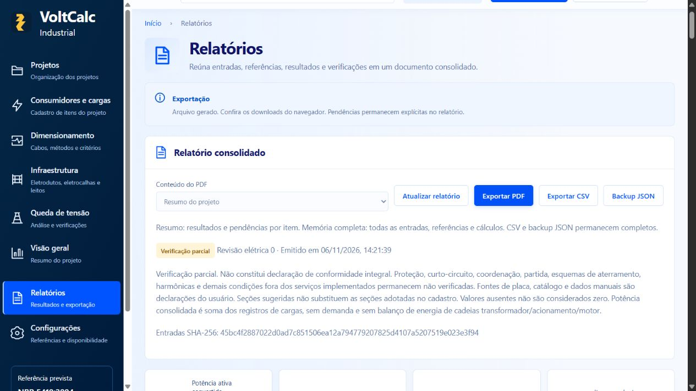

# PDF resumido — acompanhamento IND-62

Concluído em 06/11/2026, como melhoria editorial após o roteiro 0–11. Não cria nova etapa nem amplia a cobertura normativa.

## Comportamento entregue

Em Relatórios, o campo **Conteúdo do PDF** permite escolher **Resumo do projeto** (padrão da interface) ou **Memória completa**. O botão de PDF do topo também usa essa seleção. Os arquivos recebem os sufixos `-resumo.pdf` e `-memoria-completa.pdf`.

O resumo apresenta indicadores, mapa e conexões, cargas/correntes, seções sugeridas, infraestrutura, queda de tensão, pendências e versões. Motivos idênticos são agrupados com todos os itens afetados preservados. A memória completa mantém entradas, referências, fórmulas e comparação de seções. CSV e backup JSON permanecem completos nos respectivos escopos: relatório técnico e entradas recuperáveis do projeto.

Valores ausentes não viram zero; critérios ausentes aparecem como não avaliados. A legenda explica `Calculado*`, os traços e o alcance parcial das verificações. Seções sugeridas continuam distintas das adotadas. Nenhum resultado foi promovido a conformidade integral.

## Arquivos envolvidos

| Arquivo | Alteração |
|---|---|
| `voltcalc/industrial/report_summary.py` | Projeção editorial dos resultados existentes e agrupamento das pendências |
| `voltcalc/industrial/reports.py` | Campo aditivo `summarySections`, parâmetro de exportação e confirmação do perfil retornado |
| `voltcalc/industrial/report_pdf.py` | Renderização dos dois perfis, legenda e larguras de tabelas do resumo |
| `frontend/industrial/js/core/reports.js` | Solicitação e validação do perfil de PDF |
| `frontend/industrial/js/reports-controller.js` | Seleção transitória e nomes de arquivos distintos |
| `frontend/industrial/js/reports-view.js` | Seletor e explicação das opções |
| `tests/industrial/test_reports.py` | Preservação de motivos/origens, paginação e compatibilidade da API |
| `tests/industrial/reports.test.mjs` | Perfis, retorno incompatível e apresentação do seletor |
| `docs/industrial/DECISOES_ARQUITETURAIS.md` | DA-44 |
| `docs/industrial/PENDENCIAS.md` | Atualização delimitada de IND-62 |
| `docs/industrial/evidencias/pdf_resumo_desktop.jpg` | Evidência da interface verificada |

## Validação

- Regressão existente e novos testes: **227 testes Python e 18 suítes JavaScript aprovados**, executados em 05/11 e logs conferidos em 06/11. Logs locais: `tmp/industrial-summary-python.log` e `tmp/industrial-summary-js.json`.
- **105 arquivos protegidos sem alteração**, comparados por SHA-256 com `tmp/industrial_stage6_baseline.json` em 06/11, incluindo motor, dados e interface residenciais.
- Cenário sintético: **30 consumidores, 4 quadros e 33 trechos**. Resumo e memória gerados a partir das mesmas entradas, sem gravação de dados de usuário.
- Downloads reais pela interface isolada na porta 8001: **12 páginas / 71.358 bytes** no resumo; **396 páginas / 882.203 bytes** na memória completa. Ambos preservam o aviso de verificação parcial. Quantidade de páginas depende dos dados do projeto.
- Inspeção visual das 12 páginas renderizadas do resumo: tabelas e cabeçalhos legíveis, sem sobreposição ou corte de conteúdo. O mapa denso permanece pequeno, como ressalva abaixo.
- Seletor alternado entre as duas opções, nomes de download distintos e retorno ao resumo confirmados. Nenhum erro de console capturado. A captura registra a interface desktop; esta melhoria não amplia a validação anterior de dispositivos/navegadores.
- `git diff --check` sem erros de espaços.

## Compatibilidade e limites

A API mantém memória completa quando `pdfDetail` é omitido por clientes antigos; a interface atual envia explicitamente `summary` ou `full`. O servidor confirma o perfil e a interface rejeita uma resposta incompatível. A seleção não altera nem migra projetos; contrato e versões dos motores permanecem iguais.

IND-62 atendido quanto ao resumo selecionável. Compactar a própria memória detalhada não foi implementado: ela continua extensa. IND-57 e IND-64 seguem abertos quanto a mapas densos e apresentação da memória completa. Os limites elétricos da Etapa 11, incluindo proteção, curto-circuito, partida e esquemas de aterramento, permanecem sem ampliação. Não houve alteração nos projetos do usuário na origem 8000.

